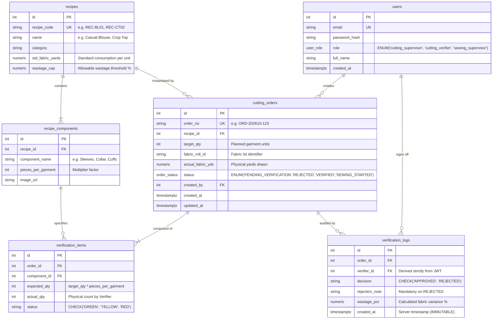
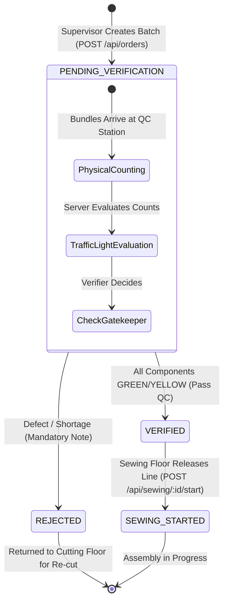

# ApparelFlow ERP — Quality Control Terminal (Frontend)

Enterprise Manufacturing Resource Planning (ERP) front-end web application engineered specifically for commercial garment production facilities. Implements the **Cutting Operations & Gatekeeper Verification Terminal** with dynamic Bill of Materials (BOM) component multiplication, real-time traffic-light piece count verification, hard-stop shortage prevention, and sewing queue isolation.

---

## 1. Technology Stack

| Domain | Technology / Tool | Specification & Purpose |
| :--- | :--- | :--- |
| **Framework** | **React 18 / 19** | Component-driven architecture, modular state management |
| **Build Tool** | **Vite 5 / 6** | Ultra-fast HMR development server & optimized production rollup bundling |
| **Routing** | **React Router DOM 6 / 7** | Client-side routing with defensive `RoleGuard` wrapper components |
| **Icons** | **Lucide React** | Production icon library for clear visual status indicators |
| **Styling** | **Vanilla CSS (Design Tokens)** | Custom CSS variable design system adhering to **Section 11 Zero-Tolerance Contrast Standards** |
| **State Management** | **React Context API** | `AuthContext` for cryptographic session lifecycle and user claims |
| **Storage** | **Web Storage (`localStorage`)** | Seamless token and user persistence across browser page reloads |
| **Reverse Proxy** | **Nginx** | Reverse proxies `/api/*` requests to Express backend; serves SPA with HTML5 pushState |
| **Cloud Hosting** | **AWS EC2 (Amazon Linux 2023)** | Production host serving static assets from `/var/www/apparelflow/` |
| **CI/CD** | **GitHub Actions** | Automated compilation and atomic SSH deployment via rsync on `push: main` |

---

## 2. Infrastructure & Network Architecture

```
[ Web Browser (End User) ]
              │
              ▼ (Port 80 HTTP)
  [ Nginx Web Server on AWS EC2 (13.233.146.254) ]
   ├── Static Files: /var/www/apparelflow (HTML, CSS, JS)
   └── Reverse Proxy: /api/* ──► [ Backend EC2: 15.207.71.143:3000 ]
```

---

## 3. Entity-Relationship (ER) Diagram

The frontend coordinates with the backend's 6 relational entities across the manufacturing lifecycle:



---

## 4. Manufacturing State Machine Architecture

The UI adheres strictly to the ERP state pipeline, rendering contextual action buttons and status badges:



---

## 5. Factory Personas & Production Role Enforcement

The application enforces real authentication and role enforcement across three distinct factory roles:

| Operational Persona | Role Key | Test Credentials | Frontend Workstation & Capabilities | Strict System Restrictions |
| :--- | :--- | :--- | :--- | :--- |
| **Cutting Supervisor** | `cutting_supervisor` | `supervisor@apparelflow.com`<br>`Password123!` | • Route: `/orders`<br>• Selects garment recipes<br>• Real-time dynamic component multiplier<br>• Creates cutting batches | ⛔ **BLOCKED** from approving/rejecting batches.<br>⛔ **BLOCKED** from viewing Sewing Queue. |
| **Cutting Verifier** | `cutting_verifier` | `verifier@apparelflow.com`<br>`Password123!` | • Route: `/verify`<br>• Physical piece count entry<br>• Real-time traffic light matrix (GREEN/YELLOW/RED)<br>• Approves batches or rejects with note | ⛔ **BLOCKED** from creating cutting orders.<br>⛔ **BLOCKED** from viewing Sewing Queue. |
| **Sewing Supervisor** | `sewing_supervisor` | `sewing@apparelflow.com`<br>`Password123!` | • Route: `/sewing`<br>• Inspects verified piece counts & audit logs<br>• Reviews fabric wastage percentage vs cap<br>• Initiates assembly line (`SEWING_STARTED`) | ⛔ **STRICTLY BLOCKED** from unverified, pending, or rejected cutting orders. |

---

## 6. Core Functional Modules

### 6.1 Dynamic Component Multiplier Engine
In the **Create Cutting Batch Modal** (`/orders`), selecting a production recipe (*Casual Blouse* or *Crop Top*) and typing a batch quantity instantly computes expected cut pieces:
$$\text{Expected Pieces} = \text{Batch Quantity} \times \text{Pieces Per Garment}$$
*(e.g., 50 garments $\times$ 2 sleeve cuffs = 100 cut cuffs expected).*

### 6.2 Traffic-Light QC Status Matrix
At the **QC Verification Terminal** (`/verify`), physical piece counts evaluate against expectations:
- 🟢 **GREEN (Match):** `Actual == Expected` &rarr; Exact match; satisfies quality criteria.
- 🟡 **YELLOW (Excess):** `Actual > Expected` &rarr; Surplus pieces recorded; batch may proceed.
- 🔴 **RED (Shortage):** `Actual < Expected` &rarr; Defect shortage; batch cannot enter assembly.

### 6.3 The Gatekeeper Hard Stop
- If **ANY** single component is flagged 🔴 **RED**, uncounted, or missing, the **"Approve Batch"** button is **strictly disabled** with an explanatory warning banner.
- The Verifier may only click **"Reject Batch"**, prompting a modal with a mandatory rejection reason note that returns the batch to the Cutting Department.

### 6.4 Sewing Queue & Fabric Wastage Analytics
- Shows verified orders released from QC.
- Displays computed Fabric Wastage percentage:
  $$\text{Fabric Wastage \%} = \left[ \frac{\text{Actual Fabric Used} - \text{Expected Fabric}}{\text{Expected Fabric}} \right] \times 100$$
- Visual indicators highlight if wastage exceeds the recipe's allowable threshold cap.
- Clicking **"Start Sewing Assembly"** transitions the order to `SEWING_STARTED`.

---

## 7. Zero-Tolerance UI Input Contrast & Accessibility (Section 11)

In strict accordance with the assessment's **Section 11 Zero-Tolerance Standard**:
- All `<input>`, `<select>`, `<textarea>`, and `<option>` elements declare explicit dark foreground text (`#111827`) against crisp white backgrounds (`#ffffff`) using `!important`.
- Eliminates any white-on-white rendering bugs across system dark modes, focus states, and dropdown menus.
- Clear inline visual error prompts accompany invalid input entries.

---

## 8. Local Setup & Build Instructions

### Prerequisites
- Node.js 20+
- Backend running at `http://localhost:3000` (or configured via Vite proxy)

### Step 1: Install Dependencies
```bash
npm install
```

### Step 2: Start Development Server
```bash
npm run dev
```
*(Runs at `http://localhost:5173` with automatic API proxying).*

### Step 3: Build for Production
```bash
npm run build
```
*(Generates optimized production bundle in `dist/`).*
